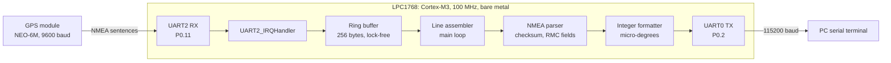
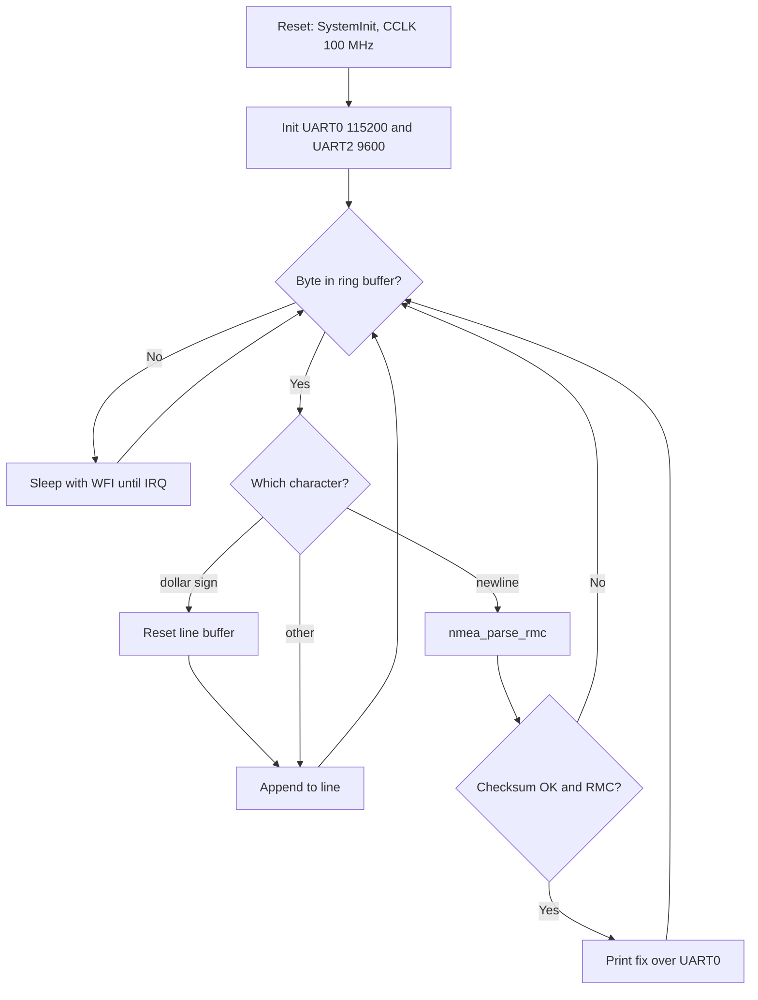
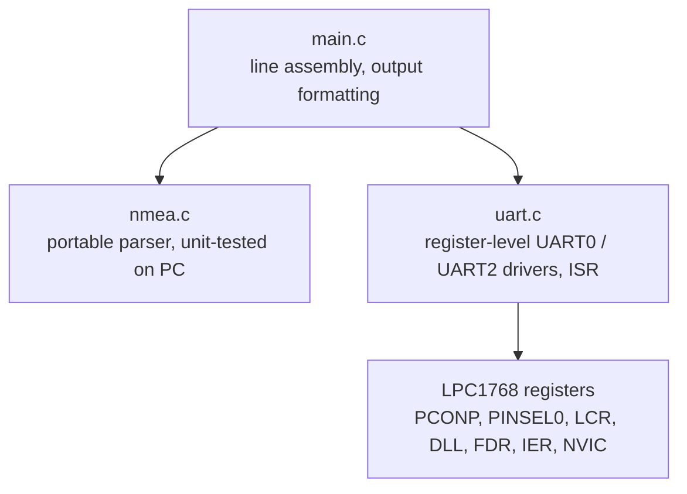

# LPC1768 GPS Tracker: Bare-Metal Embedded C (ARM Cortex-M3)

A GPS system on the **LPC1768** written in bare-metal Embedded C with **register-level drivers**,
with no vendor driver library. It receives NMEA sentences from a GPS module, validates
and parses `$xxRMC`, and streams time, date, position and speed to a serial terminal.


## Architecture



### Firmware flow



### Software layers



## Hardware

| Signal | LPC1768 pin | Settings |
|---|---|---|
| GPS TX → MCU | P0.11 (RXD2) | 9600 8N1, 3.3 V logic |
| MCU → GPS (unused) | P0.10 (TXD2) | — |
| MCU → PC | P0.2 (TXD0) | 115200 8N1 |
| PC → MCU | P0.3 (RXD0) | — |

## Register-level configuration

| Step | Register | Value | Purpose |
|---|---|---|---|
| Power | `PCONP` bit 24 | 1 | UART2 is off after reset |
| Pin mux | `PINSEL0[23:20]` | `0101` | P0.10/P0.11 → TXD2/RXD2 |
| Baud (UART2) | `DLL` / `FDR` | 163 / `0x10` | 25 MHz / (16×163) = 9586 baud (−0.15%) |
| Baud (UART0) | `DLL` / `FDR` | 9 / `0x21` | 25 MHz / (16×9×1.5) = 115740 baud (+0.47%) |
| Interrupt | `IER` bit 0 + `NVIC` | 1 | RX-data-available interrupt |

## Design details
- **Interrupt-driven RX:** the ISR drains the UART FIFO into a single-producer/single-consumer ring buffer. The CPU sleeps in `__WFI()` between bytes.
- **Robust parsing:** XOR checksum validation, empty-field handling (`,,`), any talker ID (`GP`, `GN`, `GL`).
- **No floating point:** `ddmm.mmmmm` is converted to signed micro-degrees with integer math (`degrees × 1e6 + minutes_e5 / 6`).
- **Host unit tests:** the parser is hardware-independent and tested with gcc on a PC.

## Repository structure
```
src/main.c        main loop and output formatting
src/uart.c/.h     register-level UART drivers and ISR
src/nmea.c/.h     NMEA RMC parser
tests/test_nmea.c PC unit tests for the parser
```

## Build and run
- **Keil µVision:** new LPC1768 project → add `src/*.c` + CMSIS `startup_LPC17xx.s` and `system_LPC17xx.c` → enable C99 → build → flash.
- **Host tests:**
```bash
gcc -std=c99 -Wall -Isrc tests/test_nmea.c src/nmea.c -o test_nmea && ./test_nmea
```

## Results
<!-- Paste real terminal output from your board and a photo of the setup -->
```
LPC1768 GPS tracker
UTC hh:mm:ss  dd/mm/yy  lat ...  lon ...  spd ... kn
```

## Next steps
- Add `$GPGGA` parsing (altitude, satellite count, HDOP)
- 16×2 LCD output and SD-card logging

## Tools
Embedded C · ARM Cortex-M3 · LPC1768 · Keil µVision · CMSIS · gcc
